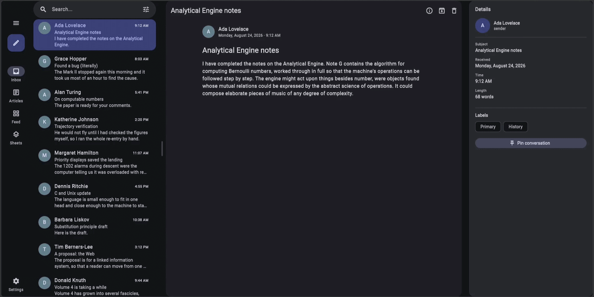

# material_layout

Material 3 adaptive layout for Flutter: breakpoints, panes, the list-detail,
supporting-pane and feed layouts and the two-pane engine they are built on,
navigation placement, resizable panes and side sheets.



Try the [demo on the web](https://kacpmu.github.io/material_layout/), or run
the one in [`demo/`](demo/): an inbox, an article reader, a feed and a
two-pane page that reports the breakpoints of the window and of each pane.
Resize the window to watch the layouts adapt, and open the settings, behind
the tune button in each screen's bar, to change the package's parameters
live.

The package follows Material 3's
[layout guidance](https://m3.material.io/foundations/layout/layout-overview/overview):
its [breakpoints](https://m3.material.io/foundations/layout/breakpoints/overview),
margins and panes, and its
[canonical layouts](https://m3.material.io/foundations/layout/canonical-examples/overview).

## Table of Contents

* [Scope](#scope)
* [Getting started](#getting-started)
  * [Installation](#installation)
  * [A first layout](#a-first-layout)
  * [Basic concepts](#basic-concepts)
* [Layouts](#layouts)
  * [Feed](#feed)
  * [List-detail](#list-detail)
  * [Supporting pane](#supporting-pane)
  * [Three-pane layout](#three-pane-layout)
  * [Custom two-pane](#custom-two-pane)
* [Navigation](#navigation)
  * [Navigation scaffold](#navigation-scaffold)
  * [Navigator and go_router](#navigator-and-go_router)
* [Resizing](#resizing)
* [Theming, motion and accessibility](#theming-motion-and-accessibility)
* [Advanced usage](#advanced-usage)
  * [How it works](#how-it-works)
  * [Margins in depth](#margins-in-depth)
  * [Limitations](#limitations)
* [License](#license)

## Scope

Supported:

* 5 width breakpoints and 3 height breakpoints, resolved against the
  region a layout occupies rather than the window.
* The canonical layouts: list-detail, supporting pane and feed, with margins,
  spacers and fixed pane widths from the breakpoint.
* A two-pane layout of the app's own, in either of Material's arrangements,
  on the engine the list-detail and supporting-pane layouts are built on.
* Pane surfaces painted to match where the layouts keep their margins: cards
  or flat panes, in the theme's colour and outline.
* Showing and hiding panes as space changes, and stacking them when there is
  no room side by side; folds and hinges are avoided.
* Resizing, by drag, keyboard and assistive technology, with snap stops,
  gestures of the app's choosing, panes that collapse to leave the other the
  whole width or that the handle dismisses, and a split that is remembered
  or forgotten.
* Navigation placement: a navigation bar or a navigation rail, chosen by the
  breakpoint and by the number of panes the body shows, as Material
  prescribes, or by a rule of the app's own.
* Side sheets, as a pane beside the content or as a modal route, and a sheet
  that is a side sheet or a bottom sheet by the width of the window.
* Right-to-left layouts, reduced motion, and Material spring motion.

Not supported:

* Navigation components of its own. `NavigationScaffold` places the
  navigation bar and rail it is given, such as those of `material_ui`. For a
  complete Material 3 Expressive layout,
  [`material_navigation`](https://pub.dev/packages/material_navigation) is
  the recommended companion package: it supplies the Expressive navigation
  bar and rail, as the demo shows.
* Floating panes. Use a dialog or a modal sheet for content above the panes.
* Storage. A split serialises to JSON; storing it is the app's concern.
* Apps built on `package:flutter/material.dart`. The widgets read the theme of
  `material_ui`, so the app's `MaterialApp` and `ThemeData` must come from it.

## Getting started

### Installation

```sh
flutter pub add material_layout material_ui
```

The widgets are built on [`material_ui`](https://pub.dev/packages/material_ui),
the Material library decoupled from the Flutter framework. Import it where you
would import `package:flutter/material.dart`:

```dart
import 'package:material_layout/material_layout.dart';
import 'package:material_ui/material_ui.dart';
```

### A first layout

An inbox that shows one pane and a navigation bar on a phone, and two
resizable panes beside a navigation rail on a wider screen:

```dart
void main() => runApp(const MaterialApp(home: Inbox()));

class Inbox extends StatefulWidget {
  const Inbox({super.key});

  @override
  State<Inbox> createState() => _InboxState();
}

class _InboxState extends State<Inbox> {
  var _destination = 0;

  @override
  Widget build(BuildContext context) => NavigationScaffold(
    navigationBar: NavigationBar(
      selectedIndex: _destination,
      onDestinationSelected: (index) => setState(() => _destination = index),
      destinations: const [
        NavigationDestination(icon: Icon(Icons.inbox), label: 'Inbox'),
        NavigationDestination(icon: Icon(Icons.send), label: 'Sent'),
      ],
    ),
    navigationRail: NavigationRail(
      selectedIndex: _destination,
      onDestinationSelected: (index) => setState(() => _destination = index),
      labelType: NavigationRailLabelType.all,
      destinations: const [
        NavigationRailDestination(icon: Icon(Icons.inbox), label: Text('Inbox')),
        NavigationRailDestination(icon: Icon(Icons.send), label: Text('Sent')),
      ],
    ),
    body: ListDetailLayout<int>(
      resizable: true,
      emptyBehavior: const ListDetailEmptyBehavior.placeholder(
        child: Center(child: Text('Select a message')),
      ),
      listBuilder: (context) {
        final layout = ListDetailLayout.of<int>(context);
        return ListView(
          children: [
            for (var id = 0; id < 20; id++)
              ListTile(
                title: Text('Message $id'),
                selected: layout.isSelected(id),
                onTap: () => layout.select(id),
              ),
          ],
        );
      },
      detailBuilder: (context, id, placement) => Scaffold(
        // A back button on a page of its own; none beside the list.
        appBar: AppBar(
          automaticallyImplyLeading: placement == DetailPlacement.page,
        ),
        body: Center(child: Text('Message $id')),
      ),
    ),
  );
}
```

The same app runs as [`example/main.dart`](example/main.dart).

### Basic concepts

#### Breakpoints and regions

| Breakpoint | Width | Margins | Fixed pane |
| --- | --- | --- | --- |
| `compact` | below 600dp | 16dp | — |
| `medium` | 600–839dp | 24dp | — |
| `expanded` | 840–1199dp | 24dp | 360dp |
| `large` | 1200–1599dp | 24dp | 412dp |
| `extraLarge` | 1600dp and wider | 24dp | 412dp |

Breakpoints describe space, not devices, and a layout resolves against the
region it occupies. Beside an 80dp navigation rail, a 900dp window leaves a
medium body; a layout nested in a pane adapts to the pane. Outside every
layout, the region is the window.

Widgets read the region they are in from `AdaptiveRegion`:

```dart
class Header extends StatelessWidget {
  const Header({super.key});

  @override
  Widget build(BuildContext context) {
    final breakpoint = AdaptiveRegion.breakpointOf(context);
    return breakpoint >= Breakpoint.expanded
        ? const WideHeader()
        : const NarrowHeader();
  }
}
```

A widget that reads only the breakpoint rebuilds only when it changes.
`AdaptiveRegion.sizeOf` reports the region's size, and
`AdaptiveRegion.heightBreakpointOf` its height breakpoint: compact below
480dp, medium to 900dp, and expanded above. `Breakpoint.margin` and
`Breakpoint.fixedPaneWidth` give the measurements of the table:

```dart
final breakpoint = AdaptiveRegion.breakpointOf(context);
final margin = breakpoint.margin; // 16 or 24
final listWidth = breakpoint.fixedPaneWidth; // 360, 412, or null
```

An app retunes the thresholds in the theme ([Theming](#theming)):

```dart
const MaterialLayoutThemeData(
  breakpoints: Breakpoints(mediumMinWidth: 640, expandedMinWidth: 900),
);
```

#### Margins

The layouts keep content 16dp (compact) or 24dp (wider) from the edges of the
window, beyond any safe-area inset. By default they set the panes in by the
margins, for panes the app paints as cards. For panes painted flat, which
reach the edges, set the placement to `MarginPlacement.inside` and pad your
content by the margins its pane reports:

```dart
ListDetailLayout<int>(
  marginPlacement: MarginPlacement.inside,
  listBuilder: (context) => ListView(
    // 16dp or 24dp on the sides where the pane meets the window's edges.
    padding: AdaptiveRegion.marginsOf(context),
    children: [for (final message in messages) Text(message.subject)],
  ),
  // …
);
```

[Margins in depth](#margins-in-depth) covers the placement, the corners of
the panes, and lining app bars up with the content.

#### Pane surfaces

`PaneSurface` paints a pane to match: a card where the layout keeps its
margins around the panes, and flat where it keeps them within. Pad content by
`PaneSurface.paddingOf`, which is Material's 16dp card padding in a card and
the reported margins in a flat pane:

```dart
ListDetailLayout<int>(
  listBuilder: (context) => const PaneSurface(child: MessageList()),
  detailBuilder: (context, id, placement) =>
      PaneSurface(child: MessageView(id: id)),
);

class MessageList extends StatelessWidget {
  const MessageList({super.key});

  @override
  Widget build(BuildContext context) => ListView(
    padding: PaneSurface.paddingOf(context),
    children: [/* … */],
  );
}
```

The surface has the panes' corners, `paneBorderRadius`, and the theme's
`paneSurfaceStyle`: the colour scheme's surface colour by default, which
blends in with a flat pane's background, or a colour or an outline of your
own, which sets each pane apart:

```dart
PaneSurface(
  color: Theme.of(context).colorScheme.surfaceContainerLow,
  outline: BorderSide(color: Theme.of(context).colorScheme.outlineVariant),
  child: const MessageList(),
);
```

`PaneSurface.inCard(context)` tells content which it is in.

#### Line length

Lines of text should hold 40 to 60 characters. `LineLength` limits its child
to a width measured in characters of the text style, so the limit follows the
type scale and text scaling:

```dart
LineLength(
  style: theme.textTheme.bodyLarge,
  child: Text(article.body, style: theme.textTheme.bodyLarge),
);

// Or 45 characters, centred in a wide pane.
LineLength(
  characters: 45,
  style: theme.textTheme.bodyLarge,
  alignment: AlignmentDirectional.topCenter,
  child: body,
);
```

#### Sheets

`showAdaptiveSheet` shows a side sheet from expanded upwards and a bottom
sheet below, by the width of the window:

```dart
showAdaptiveSheet<void>(
  context: context,
  headline: const Text('Filters'),
  builder: (context) => const Filters(),
);
```

Either form scrolls the content, so give it a column rather than a list view.
`showSideSheet` shows a modal side sheet at any width:

```dart
final applied = await showSideSheet<bool>(
  context: context,
  builder: (context) => SideSheet(
    headline: const Text('Filters'),
    actions: [
      FilledButton(
        onPressed: () => Navigator.pop(context, true),
        child: const Text('Apply'),
      ),
      OutlinedButton(
        onPressed: () => Navigator.pop(context, false),
        child: const Text('Cancel'),
      ),
    ],
    child: const Filters(),
  ),
);
```

A modal side sheet slides in from the trailing edge, blocks the content
behind a scrim, takes focus to its first element when it opens and returns
it when it closes, and follows Android's predictive back gesture. It always
has a close button. A `SideSheet` in a `SupportingPaneLayout` is a standard
sheet instead: it sits beside the content, which shrinks to make room, and
has a close button only where it can be closed
([Supporting pane](#supporting-pane)).

## Layouts

### Feed

A scrolling feed of items that reflows by column count.

```
┌────────────┐      ┌─────────────────────┐
│ 0          │      │ 0, two columns wide │
├────────────┤      ├──────────┬──────────┤
│ 1          │      │ 1        │ 2        │
├────────────┤      ├──────────┼──────────┤
│ 2          │      │ 3        │ 4        │
└────────────┘      └──────────┴──────────┘
 compact             wider: as many columns as fit
```

```dart
FeedLayout(
  minItemWidth: 280,
  gap: 16,
  itemCount: articles.length,
  // The first article spans two columns wherever there are two.
  spanBuilder: (index, columns) => index == 0 ? 2 : 1,
  itemBuilder: (context, index) => ArticleCard(articles[index]),
);
```

* One column at compact; above it, as many columns as fit at
  `minItemWidth`, `gap` apart.
* Items keep their order, row by row, and may differ in height and span.
* The feed keeps the margins of its region, and its first and last items
  start clear of the safe area.

### List-detail

A collection beside the detail of the item selected from it: an inbox and a
message, files and a file, settings and a category.

```
┌─────────────┐   ┌─────────────┐   ┌───────────┬──────────────────┐
│ Message 1   │   │ ← Message 2 │   │ list      │ detail of the    │
│ Message 2   │   │             │   │ 360dp or  │ selected item    │
│ Message 3   │   │ (a page)    │   │ 412dp     │                  │
│             │   │             │   │           │                  │
└─────────────┘   └─────────────┘   └───────────┴──────────────────┘
 one pane: list    or detail         two panes
```

```dart
ListDetailLayout<int>(
  listBuilder: (context) {
    final layout = ListDetailLayout.of<int>(context);
    return ListView(
      children: [
        for (final message in messages)
          ListTile(
            title: Text(message.subject),
            selected: layout.isSelected(message.id),
            onTap: () => layout.select(message.id),
          ),
      ],
    );
  },
  // The same place in the tree in both placements, which keeps the
  // message's state as it moves; only the page has an app bar.
  detailBuilder: (context, id, placement) => Scaffold(
    appBar: placement == DetailPlacement.page ? AppBar() : null,
    body: MessageView(id: id),
  ),
);
```

* One pane below `twoPaneBreakpoint` — expanded by default — and two at and
  above it. Pass `Breakpoint.medium` to split medium windows evenly.
* With one pane, selecting an item pushes its detail as a page, so the
  page's app bar has a back button and the system back button returns to the
  list. With two, the detail sits beside the list, which marks the selected
  item. Going from two panes to one with an item selected shows its page.
* `detailBuilder` is told where the detail goes. Build the same content for
  both placements, at the same place in the tree, and vary only the chrome:
  the detail then keeps its state, scroll position and focus as it moves
  between the pane and the page.
* Resizing the window changes the placement and nothing else: the selection
  stays, and nothing navigates.

#### What two panes show with nothing selected

```dart
// A placeholder beside the list, the default.
emptyBehavior: const ListDetailEmptyBehavior.placeholder(
  child: Center(child: Text('Select a message')),
),

// The list alone, until an item is selected.
emptyBehavior: const ListDetailEmptyBehavior.hidePane(),

// An item of your choosing, usually the first, marked in the list.
emptyBehavior: ListDetailEmptyBehavior.select(messages.first.id),
```

With `select`, pass the id on every build, so that it follows the list as
items come and go; only a layout that builds its own detail can show one.

#### Closing the detail

With two panes the detail has no back button, since the list is beside it.
Where two panes have something to show with nothing selected — a placeholder,
or the list alone — give the detail a close button instead:

```dart
detailBuilder: (context, id, placement) {
  final layout = ListDetailLayout.of<int>(context);
  return Scaffold(
    appBar: AppBar(
      automaticallyImplyLeading: placement == DetailPlacement.page,
      actions: [
        if (layout.canClose)
          IconButton(
            tooltip: MaterialLocalizations.of(context).closeButtonTooltip,
            icon: const Icon(Icons.close),
            onPressed: layout.close,
          ),
      ],
    ),
    body: MessageView(id: id),
  );
},
```

`close` clears the selection and moves focus from the detail back to the list,
to the item that opened it. With `ListDetailEmptyBehavior.select` the detail
cannot be closed, as closing would only show another item.

#### Who owns the selection

The layout keeps the selection unless given `onSelectionChanged`; the caller
then owns it, and passes it back as `selectedId`:

```dart
ListDetailLayout<int>(
  selectedId: _selected,
  onSelectionChanged: (id) => setState(() => _selected = id),
  // …
);
```

A layout that owns its selection restores it, with the split, when given a
`restorationId` in an app with state restoration:

```dart
MaterialApp(
  restorationScopeId: 'app',
  home: ListDetailLayout<int>(
    restorationId: 'inbox',
    // …
  ),
);
```

`ListDetailLayout.custom` takes the detail as a widget instead of building
it, and mounts no navigator of its own; see
[Navigator and go_router](#navigator-and-go_router).

### Supporting pane

Primary content, and secondary content that is meaningful only beside it.

```
┌─────────────────────┐     ┌────────────────────────┬─────────────┐
│ focus               │     │ focus                  │ supporting  │
│                     │     │                        │ 360dp or    │
├─────────────────────┤     │                        │ 412dp       │
│ supporting pane,    │     │                        │             │
│ a third as high     │     │                        │             │
└─────────────────────┘     └────────────────────────┴─────────────┘
 compact and medium          expanded and wider
```

```dart
SupportingPaneLayout(
  focus: const ArticleView(),
  supporting: const RelatedArticles(),
);
```

* Compact and medium: below the focus pane, taking a third of the height.
* Expanded and wider: beside it, 360dp or 412dp wide, on the trailing side,
  or the leading side with `supportingSide: PaneSide.leading`.
* The pane animates in and out as `supporting` changes between a widget and
  null.

A supporting pane is permanent, or temporary: one the user can close.
`onSupportingDismissed` makes it temporary, and the caller removes it in
response:

```dart
SupportingPaneLayout(
  focus: const ArticleView(),
  supporting: _showRelated ? const RelatedArticles() : null,
  onSupportingDismissed: () => setState(() => _showRelated = false),
);
```

A standard side sheet is a supporting pane of its own kind. It sits beside
the content from medium, always on the trailing edge, at its own width,
400dp at most, and is hidden rather than stacked at compact, where its
content belongs in a modal sheet:

```dart
SupportingPaneLayout(
  focus: const MessageView(),
  supporting: _showFilters
      ? const SideSheet(headline: Text('Filters'), child: Filters())
      : null,
  onSupportingDismissed: () => setState(() => _showFilters = false),
);
```

In a temporary pane the sheet's close button closes the pane. In a
permanent one — without `onSupportingDismissed` — the sheet has no close
button, unless it is given its own `onClose`, and stays until the app
removes it:

```dart
// Always beside the content, from medium upwards.
SupportingPaneLayout(
  focus: const Editor(),
  supporting: const SideSheet(
    headline: Text('Properties'),
    child: Properties(),
  ),
);
```

`resizable: true` lets the user resize a temporary supporting pane with a
drag handle, and dismiss it by dragging the handle to the edge. A permanent
pane has no handle and keeps its width; the focus pane is never hidden.

### Three-pane layout

A list-detail layout as the focus of a supporting pane layout makes the third
pane of an inbox: the list, the selected message, and its details in a side
sheet.

```dart
class Inbox extends StatefulWidget {
  const Inbox({super.key});

  @override
  State<Inbox> createState() => _InboxState();
}

class _InboxState extends State<Inbox> {
  int? _selected;
  bool _details = false;

  @override
  Widget build(BuildContext context) {
    final selected = _selected;
    return SupportingPaneLayout(
      // The selected message's details, which close with the selection.
      supporting: _details && selected != null
          ? SideSheet(
              headline: const Text('Details'),
              child: MessageDetails(id: selected),
            )
          : null,
      onSupportingDismissed: () => setState(() => _details = false),
      focus: ListDetailLayout<int>(
        selectedId: selected,
        onSelectionChanged: (id) => setState(() => _selected = id),
        listBuilder: (context) => const MessageList(),
        detailBuilder: (context, id, placement) => Scaffold(
          appBar: AppBar(
            automaticallyImplyLeading: placement == DetailPlacement.page,
            actions: [
              IconButton(
                tooltip: 'Details',
                icon: const Icon(Icons.info_outline),
                onPressed: () => setState(() => _details = !_details),
              ),
            ],
          ),
          body: MessageView(id: id),
        ),
      ),
    );
  }
}
```

* At extra-large, the list, the message and the details sit side by side:
  Material's third pane, which only a standard side sheet may take.
* Below extra-large the sheet takes the list's room. The list slides out and
  the message becomes a page with a back button; when the sheet closes, the
  page turns back into the pane where it stands and the list slides back in.
* Going back from that page clears the selection, which closes the sheet
  here, so the message's pane stands where the page did, showing what two
  panes show with nothing selected, as the list returns.
* A side sheet sits beside the content from medium only; below it, show the
  details with `showAdaptiveSheet`, as the demo's inbox does.

### Custom two-pane

`TwoPaneLayout` is the engine the list-detail and supporting-pane layouts are
built on, for a layout of your own: Material's advice for a custom layout is
to build it on the canonical ones.

```dart
TwoPaneLayout(
  // An outline of fixed width beside the document; below expanded, the
  // document alone.
  first: const PaneSurface(child: Outline()),
  second: const PaneSurface(child: Document()),
  reflow: PaneReflow.second,
  resizable: true,
);
```

`arrangement` is one of Material's two: a fixed pane beside a flexible one,
360dp or 412dp by the breakpoint unless given a `width`, or two flexible
panes with the spacer centred in the window. At medium the panes split
evenly either way.

```
┌───────┬────────────┐   ┌────────────┬───────┐    ┌──────────┬──────────┐
│ fixed │ flexible   │   │ flexible   │ fixed │    │ flexible │ flexible │
│       │            │   │            │       │    │          │          │
│       │            │   │            │       │    │          │          │
└───────┴────────────┘   └────────────┴───────┘    └──────────┴──────────┘
 fixedAndFlexible()       fixed: PaneSlot.second    splitPane()
```

```dart
// A fixed pane of 300dp on the trailing side.
TwoPaneLayout(
  arrangement: const PaneArrangement.fixedAndFlexible(
    fixed: PaneSlot.second,
    width: 300,
  ),
  first: const Editor(),
  second: const Preview(),
);

// Two panes of equal weight, split evenly.
TwoPaneLayout(
  arrangement: const PaneArrangement.splitPane(),
  first: const Original(),
  second: const Translation(),
);
```

The panes sit side by side from `twoPaneBreakpoint`, expanded by default.
Below it, `reflow` stacks them, the first above the second, or shows only one
of them:

```
┌──────────────┐    ┌──────────────┐    ┌──────────────┐
│ first        │    │ first        │    │ second       │
├──────────────┤    │              │    │              │
│ second       │    │              │    │              │
└──────────────┘    └──────────────┘    └──────────────┘
 stack               first               second
```

Either pane may be null: it leaves on the pane motion, and the other takes
the whole layout. `onFirstDismissed` and `onSecondDismissed` make a pane one
the user can close, with the drag handle or a `SideSheet`'s close button in
it:

```dart
TwoPaneLayout(
  first: const Document(),
  second: _comments ? const Comments() : null,
  onSecondDismissed: () => setState(() => _comments = false),
  resizable: true,
);
```

Everything the canonical layouts do comes with it: regions, margins, folds
and hinges, the pane budget of nested layouts, the pane count the navigation
scaffold places navigation by, motion and resizing.

## Navigation

### Navigation scaffold

```
┌────────────┐    ┌──────┬────────────┐    ┌──────┬────────┬────────────┐
│ body       │    │ rail │ one pane   │    │ rail │ list   │ detail     │
│            │    │      │            │    │      │        │            │
│            │    │      │            │    │      │        │            │
├────────────┤    │      │            │    │      │        │            │
│ bar        │    │      │            │    │      │        │            │
└────────────┘    └──────┴────────────┘    └──────┴────────┴────────────┘
 compact           medium, one pane         expanded and wider
```

```dart
NavigationScaffold(
  navigationBar: NavigationBar(/* … */),
  navigationRail: NavigationRail(/* … */),
  body: ListDetailLayout<int>(/* … */),
);
```

| Breakpoint | Body | Navigation |
| --- | --- | --- |
| compact | any | bar |
| medium | one pane | rail |
| medium | two panes | bar |
| expanded and wider | any | rail |

* The layouts report how many panes they show, so the scaffold follows them
  without being told; `paneCount` tells it instead.
* The leaving component goes before the arriving one comes, on the
  scaffold's `PaneMotion`. The layouts in the body arrange themselves at once
  for the room they will have when the swap is done, while the body's width
  follows the rail: two panes never show on the way to a rail that leaves
  room for one.
* Where the component the placement calls for is missing, no navigation
  shows rather than the other one: a compact app may keep a modal rail in
  its drawer instead of a bar.
* The other `Scaffold` arguments pass through, and the body sees the insets a
  `Scaffold`'s body does. A navigation bar holds 3 to 5 destinations;
  the scaffold says so in debug builds.

Widgets below the scaffold learn which placement shows:

```dart
final placement = NavigationScaffold.placementOf(context);
// A floating action button in the bar's place, or in the rail.
final showFab = placement == NavigationPlacement.bar;
```

Material requires this placement, and it is the default. For another, give
`placementRule` a `NavigationPlacementRule`: `only` shows one placement at
every breakpoint, and `from` decides by the breakpoint and the pane count:

```dart
// The bar alone, at every breakpoint.
NavigationScaffold(
  navigationBar: NavigationBar(/* … */),
  placementRule: const NavigationPlacementRule.only(NavigationPlacement.bar),
  body: body,
);

// A rail up to expanded, and the bar from expanded upwards.
NavigationScaffold(
  navigationBar: NavigationBar(/* … */),
  navigationRail: NavigationRail(/* … */),
  placementRule: NavigationPlacementRule.from(
    (breakpoint, paneCount) => breakpoint < Breakpoint.expanded
        ? NavigationPlacement.rail
        : NavigationPlacement.bar,
  ),
  body: body,
);
```

A rule that goes by the pane count sees the panes in the room the
navigation leaves them: a rail narrows the body, which may then show fewer
panes. Material's rule gives two panes the bar, so its placement holds;
just past medium, where two panes fit only without the rail's width, it
keeps the navigation the window had. A rule giving two panes the rail and
one the bar can swap them back and forth.

A rail is the edge of the window on its side, so the layouts beside it keep
no margin there: the first pane starts where the rail ends, which is what
keeps the split centred in the window, the rail and the first pane taking
half of it.

### Navigator and go_router

The package works with any navigation: plain `Navigator` routes, the `Router`
API and go_router alike. It never reads or writes a URL, and a resize never
navigates.

* At one pane, `ListDetailLayout` pushes the detail's page on a navigator of
  its own, in the list pane's place. The system back button, and Android's
  predictive back gesture, return from it to the list.
* A route pushed from inside the layout with `Navigator.of(context)` opens on
  that navigator too, within the layout's region. Push with
  `Navigator.of(context, rootNavigator: true)` to cover the whole screen.
* The sheets open on the root navigator by default, as window-level
  surfaces.

To keep the selection in a URL, let the router own it: pass it in as
`selectedId`, and turn selections into navigation with
`onSelectionChanged`:

```dart
ListDetailLayout<int>(
  selectedId: selectedId,
  onSelectionChanged: (id) => context.go(id == null ? '/inbox' : '/inbox/$id'),
  // …
);
```

With go_router, give the routes for `/inbox` and `/inbox/:id` the same page
key and no transition, so that a new selection updates the page in place
rather than pushing another:

```dart
GoRoute(
  path: '/inbox',
  pageBuilder: (context, state) => const NoTransitionPage(
    key: ValueKey('inbox'),
    child: RoutedInbox(selectedId: null),
  ),
),
GoRoute(
  path: '/inbox/:id',
  pageBuilder: (context, state) => NoTransitionPage(
    key: const ValueKey('inbox'),
    child: RoutedInbox(
      selectedId: int.tryParse(state.pathParameters['id']!),
    ),
  ),
),
```

`ListDetailLayout.custom` takes the detail as a widget instead of building
it, and mounts no navigator of its own: pass it the navigator of a shell
route, and the caller navigates back by clearing the selection.

```dart
ShellRoute(
  builder: (context, state, child) => ListDetailLayout<int>.custom(
    selectedId: int.tryParse(state.pathParameters['id'] ?? ''),
    onSelectionChanged: (id) =>
        context.go(id == null ? '/files' : '/files/$id'),
    listBuilder: (context) => const FileList(),
    // The shell route's navigator, which stays mounted as the layout
    // changes between one and two panes.
    detail: child,
  ),
  routes: [/* … */],
);
```

The demo runs its screens under go_router in
[`demo/lib/main_router.dart`](demo/lib/main_router.dart), with the inbox
selection in the URL:

```sh
cd demo
flutter run                          # plain state
flutter run -t lib/main_router.dart  # go_router, selection in the URL
```

## Resizing

`resizable: true` puts a drag handle between two panes. Dragging settles on
360dp, 412dp or the centred split, the even split at medium, or the end on
either side where the handle may hide a pane.

| Input | By default |
| --- | --- |
| Drag | Resizes, settling on the nearest stop, or the next one in a fling |
| Tap | Returns to the default split (`PaneResizer.restore`) |
| Double tap | Hides a pane, or shows both again (`PaneResizer.toggle`) |
| Long press | Splits the panes evenly (`PaneResizer.splitEvenly`) |
| Enter, Space | Hides a pane, or shows both again, always |
| Arrow keys | Move to the adjacent stop |
| Home, End | Move to the first or the last stop |

Screen readers treat the handle as a slider, with the split as a percentage,
an action per stop, and an announcement of where a gesture, a key or an
action leaves the panes. A long press acts when the handle is let go; a
handle held and then moved is dragged. A drag stops at the minimum width of
a pane the handle may not hide. The handle comes in with a pane that
enters, fading in, and takes input once the pane has arrived; as a pane
goes, the handle fades out where it is.

When a pane hides, the space between the panes closes and the other pane
takes the whole width, which it keeps at every breakpoint while the split is
remembered. The handle rests in the middle of the margin beside the hidden
pane, from where it shows the pane again. Beside a navigation rail, which
takes the margin's place, it rests half a spacer inside the pane that
stays, as Material shows.

```
┌──────────┐   ┌──────────────────┐       ┌─────────────────────────────┐
│ list     │ ┃ │ detail           │     ┃ │ detail, the whole width     │
│          │ ┃ │                  │     ┃ │                             │
│          │ ┃ │                  │     ┃ │                             │
└──────────┘   └──────────────────┘       └─────────────────────────────┘
 both panes, the handle between         list hidden: the handle in the margin
```

### Which pane the handle hides

A `PaneCollapse` per pane says what the handle may do to it: `never` hide it,
`collapse` it, leaving the other pane the whole width, or `dismiss` it, as a
temporary pane, which the app then removes. By default the handle follows
Material: it collapses the fixed pane, either of two flexible panes, and at
medium, where two panes split evenly, either pane; above medium it never
hides the flexible pane beside a fixed one. Where it would collapse a pane
that can be dismissed, it dismisses the pane instead.

| Layout | Pane | Default | Can be set with |
| --- | --- | --- | --- |
| `ListDetailLayout` | list | collapse | `listCollapse`: never or collapse |
| `ListDetailLayout` | detail | collapse at medium, never above | `detailCollapse`; dismiss only with `ListDetailEmptyBehavior.hidePane` |
| `SupportingPaneLayout` | supporting | dismiss, where the pane is temporary | — |
| `SupportingPaneLayout` | focus | never | — |
| `TwoPaneLayout` | fixed, or either of two flexible panes | collapse, or dismiss where it can be dismissed | `firstCollapse`, `secondCollapse` |
| `TwoPaneLayout` | flexible, beside a fixed pane | never, or at medium as the fixed pane | `firstCollapse`, `secondCollapse` |

```dart
ListDetailLayout<int>(
  resizable: true,
  // The list stays; hiding the detail closes it, clearing the selection,
  // and the list shows alone.
  listCollapse: PaneCollapse.never,
  detailCollapse: PaneCollapse.dismiss,
  emptyBehavior: const ListDetailEmptyBehavior.hidePane(),
  // …
);

TwoPaneLayout(
  resizable: true,
  // Either pane collapses, leaving the other the whole width.
  firstCollapse: PaneCollapse.collapse,
  secondCollapse: PaneCollapse.collapse,
  first: const Outline(),
  second: const Document(),
);
```

Selecting an item while a list-detail layout's detail is hidden shows it
again. A supporting pane is only ever dismissed, and only where it is
temporary: a permanent supporting pane has no handle.

### Gestures and grips

`PaneResizer` supplies the handle's behaviour to any grip. Its `snapStops`
replace Material's stops; an empty list lets a drag rest anywhere between
the panes' minimum widths. `onTap`, `onDoubleTap` and `onLongPress` choose
what the gestures do, with the `PaneHandle` they are made on; null turns a
gesture off, and without a double tap a single tap is not held back to wait
for one:

```dart
ListDetailLayout<int>(
  resizable: true,
  dragHandle: PaneResizer(
    // A tap hides a pane or shows both, at once.
    onTap: PaneResizer.toggle,
    onDoubleTap: null,
    // A long press moves on to the next stop, from the last to the first.
    onLongPress: (handle) {
      final stops = handle.stops;
      final next = stops.indexOf(handle.split) + 1;
      handle.moveTo(stops[next % stops.length]);
    },
  ),
  // …
);
```

Give a `PaneResizer` a grip of your own to change how the handle looks while
keeping what it does. The grip reads the handle's states, hovered, focused,
pressed and dragged, and the handle itself:

```dart
class Grip extends StatelessWidget {
  const Grip({super.key});

  @override
  Widget build(BuildContext context) {
    final states = PaneResizer.statesOf(context);
    final active =
        states.contains(WidgetState.pressed) ||
        states.contains(WidgetState.dragged);
    final colors = Theme.of(context).colorScheme;
    return AnimatedContainer(
      duration: const Duration(milliseconds: 150),
      width: active ? 8 : 4,
      height: 40,
      decoration: BoxDecoration(
        color: active ? colors.primary : colors.outline,
        borderRadius: BorderRadius.circular(4),
      ),
    );
  }
}

ListDetailLayout<int>(
  resizable: true,
  dragHandle: const PaneResizer(child: Grip()),
  // …
);
```

`PaneHandle.maybeOf(context)` gives a grip, or a handle of your own, the
split, the stops, and `toggle` and `moveTo`, which announce the change to
screen readers. To restyle the default grip only, give it a style, or set
the theme's `dragHandleStyle`:

```dart
const PaneResizer(
  child: PaneDragHandle(
    style: DragHandleStyle(thickness: 6, length: 40, pressedLength: 44),
  ),
);
```

### Keeping the split

A `PaneSplitController` observes and sets the split, and serialises it:

```dart
final split = PaneSplitController(
  split: stored == null ? PaneSplit.automatic : PaneSplit.fromJson(stored),
);
split.addListener(() => save(jsonEncode(split.value.toJson())));

ListDetailLayout<int>(
  resizable: true,
  splitController: split,
  // …
);

// Set it from anywhere: hide the list, or show both panes again.
split.value = PaneSplit.collapsed;
split.toggle();
```

`PaneResizeMemory.persistent`, the default of the list-detail and two-pane
layouts, keeps the split across breakpoints; `temporary`, the supporting
pane's default, forgets it when the pane closes and reopens or the
breakpoint changes. A split that settles on the breakpoint's default width
stays the default, and follows the next breakpoint.

## Theming, motion and accessibility

### Theming

How the package's widgets look is set once, as a theme extension:

```dart
MaterialApp(
  theme: ThemeData(
    colorSchemeSeed: Colors.indigo,
    extensions: const [
      MaterialLayoutThemeData(
        breakpoints: Breakpoints(expandedMinWidth: 900),
        paneBorderRadius: BorderRadius.all(Radius.circular(16)),
        motionScheme: MotionScheme.standard(),
        dragHandleStyle: DragHandleStyle(thickness: 6),
        paneSurfaceStyle: PaneSurfaceStyle(
          outline: BorderSide(color: Color(0xFFC4C6CF)),
        ),
        sideSheetStyle: SideSheetStyle(modalBarrierColor: Color(0x66000000)),
      ),
    ],
  ),
  home: const Inbox(),
);
```

| Token | What it sets |
| --- | --- |
| `breakpoints` | The widths and heights at which breakpoints change. |
| `marginPlacement` | Whether the layouts keep their margins around the panes or within them. |
| `paneBorderRadius` | The corners the app paints its panes with, which the layouts keep while panes move. |
| `motionScheme` | The motion tokens of panes, sheets and navigation. |
| `dragHandleStyle` | The size and colours of the drag handle. |
| `paneSurfaceStyle` | The colour and outline of a `PaneSurface`. |
| `sideSheetStyle` | The colours of standard and modal side sheets, and the scrim behind a modal one. |

A value resolves as Flutter's own do: a widget's argument, such as
`PaneSurface.color`, `SideSheet.backgroundColor` or `PaneDragHandle.style`,
then the theme, then Material's default. The theme holds only how things
look. What they do stays on each widget: callbacks and gestures, whether
panes resize and which of them collapse, what a resize remembers, where a
layout changes its arrangement, and where navigation shows.

`MaterialLayoutTheme` overrides the tokens for a subtree, and
`MaterialLayoutTheme.of(context)` reads those in effect:

```dart
MaterialLayoutTheme(
  data: MaterialLayoutTheme.of(context).copyWith(
    marginPlacement: MarginPlacement.inside,
  ),
  child: const Settings(),
);
```

### Motion

Motion is spring-based: `MotionScheme.expressive()`, the default, or
`MotionScheme.standard()`, whose springs are close to critically damped.
Replace a token with a spring or a curve of your own:

```dart
const MotionScheme.expressive().copyWith(
  defaultSpatial: const Motion.spring(dampingRatio: 0.9, stiffness: 500),
);
```

A layout, a sheet and the navigation scaffold also take a `PaneMotion` of
their own, whose enter, exit and resize motions may be springs or timed
curves; the scaffold swaps the bar and the rail on its exit and enter
motions:

```dart
ListDetailLayout<int>(
  motion: PaneMotion(
    enter: const MotionScheme.expressive().defaultSpatial,
    exit: const Motion.curved(
      duration: Duration(milliseconds: 200),
      curve: Easing.standardAccelerate,
    ),
  ),
  // …
);

// Or no motion at all, for this layout.
ListDetailLayout<int>(
  motion: const PaneMotion.none(),
  // …
);
```

Nothing moves when the platform asks for reduced motion.

### Accessibility

* Right-to-left layouts mirror: the list and the rail move to the right, and
  side sheets to the left.
* Reduced motion is followed everywhere: panes, sheets and navigation change
  at once.
* The drag handle has a 48dp target and is a slider to screen readers, with
  the split as a percentage, an action per stop, and an announcement when a
  pane collapses or expands. The arrow keys move between the stops, Home and
  End to either end, and Enter or Space hides a pane and shows it again,
  whatever gestures the app gives the handle.
* Closing a detail moves focus back to the list, to the item that opened it.
  A modal side sheet takes focus when it opens, returns it when it closes,
  and is a dialog to screen readers.
* `LineLength` measures in characters of the text style, so it follows text
  scaling.

### Localizations

The package's strings — the drag handle's label, value, actions and
announcements, and the side sheet's label — come from
`MaterialLayoutLocalizations`, in English unless the app translates them.
Extend `DefaultMaterialLayoutLocalizations` for a language, and list a
delegate for it before `MaterialLayoutLocalizations.delegate`, which stands
in for every locale you don't translate:

```dart
class GermanLayoutLocalizations extends DefaultMaterialLayoutLocalizations {
  const GermanLayoutLocalizations();

  @override
  String get paneResizerLabel => 'Bereiche anpassen';

  @override
  String get sideSheetLabel => 'Seitenblatt';

  // …
}

class GermanLayoutLocalizationsDelegate
    extends LocalizationsDelegate<MaterialLayoutLocalizations> {
  const GermanLayoutLocalizationsDelegate();

  @override
  bool isSupported(Locale locale) => locale.languageCode == 'de';

  @override
  Future<MaterialLayoutLocalizations> load(Locale locale) =>
      SynchronousFuture(const GermanLayoutLocalizations());

  @override
  bool shouldReload(GermanLayoutLocalizationsDelegate old) => false;
}

MaterialApp(
  localizationsDelegates: const [
    GermanLayoutLocalizationsDelegate(),
    MaterialLayoutLocalizations.delegate,
    // The app's other delegates.
  ],
  // …
);
```

## Advanced usage

### How it works

**Regions.** `AdaptiveRegion` measures the space it is given and resolves the
breakpoints against it, and every pane of every layout is a region. So a
layout nested in a pane adapts to the pane, and one beside a rail to the
body. While a pane grows or shrinks for one that enters or leaves beside it,
the content of a region as wide as the pane is arranged for the width the
pane will rest at: it rearranges once, as the motion begins, rather than as
the pane passes a breakpoint.

**Two panes.** Every layout arranges at most two panes along an axis, with
the 24dp spacer between them and an optional drag handle on it. A pane that
enters or leaves moves on the pane motion; its content keeps its width and
slides, clipped to the space the pane occupies and to the corners the app
gives its panes. A third pane is a layout nested in another's pane.
`TwoPaneLayout` is this engine, with Material's arrangements, for layouts of
an app's own.

**The pane budget.** Material allows 3 panes at most, and 3 side by side
only at extra-large, where the third is a standard side sheet. Each layout
tells the layouts nested in its panes what is left: beside the list,
the detail pane has the rest and the list keeps to one; the focus pane has
what the supporting pane leaves. A nested layout without room for two panes
shows one.

**Margins.** The margins lie around the panes or within them, as the theme,
or a layout's `marginPlacement`, says. A nested layout keeps them where the
layout around it does, and a rail takes the leading margin's place. A
two-pane layout given as another's pane keeps the margins it meets itself.

**The list-detail page.** At one pane, the list-detail layout pushes the
detail as a page on a navigator of its own, in the list pane's place. The
detail keeps its element as it moves between the pane and the page. A change
of the window moves it at once; room that another pane takes or gives back
moves it with motion.

**Navigation.** The layouts report how many panes they show to the
`NavigationScaffold` above them, which places a bar or a rail by the
breakpoint and that count.

**Folds and hinges.** The layouts read the window's display features: a
vertical hinge puts one pane on each side of it, a half-open horizontal fold
stacks the panes above and below it, and a compact region keeps to one pane.

### Margins in depth

Margins keep content 16dp (compact) or 24dp from the edges of the window,
beyond any safe-area inset. Where a layout keeps them depends on how the app
paints its panes, which the layout cannot see:

* `MarginPlacement.outside`, the default, for panes painted as cards: the
  layouts set the panes in by the margins, and so keep every widget clear of
  the edges by themselves.
* `MarginPlacement.inside`, for panes painted flat: the panes reach the
  edges, and their content keeps the margins itself, as
  `AdaptiveRegion.marginsOf` reports them. A pane beside an edge is wider by
  the margin there, so its content has the same width and place either way.

Set the placement once, with `MaterialLayoutThemeData.marginPlacement`. A
layout's own `marginPlacement` overrides it, and a nested layout keeps the
placement of the layout around it. Most apps paint the one pane of a compact
window flat, and use cards in wider windows:

```dart
MaterialApp(
  builder: (context, child) {
    final theme = MaterialLayoutTheme.of(context);
    final width = MediaQuery.sizeOf(context).width;
    final flat = theme.breakpoints.forWidth(width) == Breakpoint.compact;
    return MaterialLayoutTheme(
      data: theme.copyWith(
        marginPlacement: flat
            ? MarginPlacement.inside
            : MarginPlacement.outside,
        paneBorderRadius: flat
            ? BorderRadius.zero
            : BorderRadius.circular(16),
      ),
      child: child!,
    );
  },
  home: const Inbox(),
);
```

`paneBorderRadius` gives the layouts the corners the app paints its panes
with. A pane that enters or leaves is clipped to the space it occupies, and a
list-detail layout at one pane clips the detail's page, and the transition it
comes and goes with, to the pane's place. With the corners, a card keeps its
shape while it moves, down to a sliver; without them, its moving edge is
square. A `SideSheet` used as a pane is painted with the same corners.

#### Content, app bars and other components

Material's components keep an inset of their own: an app bar's icons and
title, a list item's text and a tab's label start 16dp in. They line up with
content that starts 16dp in as well:

* In a card, pad content by 16dp, Material's own card padding.
* In a flat pane, pad your own content by `AdaptiveRegion.marginsOf`. In a
  compact window that is 16dp beyond the safe area, where Material's
  components already are, so they need nothing.

Set up this way, every Material app bar — small, centre-aligned, medium and
large, their sliver forms, and tabs below them — lines up with the content,
in a pane and on a page, expanded and collapsed. Give a detail the same app
bar in both placements, and vary only the back button, which belongs on the
page.

Three of Flutter's own defaults are off in any app, whatever the layout:

* The last action's icon ends 12dp from the edge, or 8dp where tap targets
  are not padded, as on desktop, where Material places it 16dp in. Set
  `AppBarTheme.actionsPadding` for the whole app: 4dp at the end with padded
  tap targets, 8dp without.
* A `FlexibleSpaceBar` starts its title 72dp in whenever the bar could show
  a back button, and at the edge otherwise. Set its `titlePadding`.
* Scrollable tabs start 52dp in, by Material's design. Set
  `tabAlignment: TabAlignment.start` to start them with the content.

```dart
ThemeData(
  appBarTheme: const AppBarTheme(
    actionsPadding: EdgeInsetsDirectional.only(end: 4),
  ),
);
```

#### Bars on a flat surface with 24dp margins

From medium up the margins are 24dp, so a bar on a flat surface there, such
as a feed's header or a flat pane in a wide window, starts 8dp before the
content. Move it in by what the margins add to its own inset. An app bar
keeps clear of the safe area itself, so it takes the margins less the
safe-area padding:

```dart
final margins = AdaptiveRegion.marginsOf(context);
final insets = MediaQuery.paddingOf(context);
final rtl = Directionality.of(context) == TextDirection.rtl;
final start = margins.start - (rtl ? insets.right : insets.left);
final end = margins.end - (rtl ? insets.left : insets.right);
// An icon button's icon sits 12dp inside its target, or 8dp inside one
// that is not padded.
final padded =
    Theme.of(context).materialTapTargetSize == MaterialTapTargetSize.padded;
final iconInset = padded ? 12.0 : 8.0;

AppBar(
  titleSpacing: start,
  actionsPadding: EdgeInsetsDirectional.only(end: end - iconInset),
  title: const Text('Feed'),
  actions: actions,
);
```

* With a back button, widen its slot so that its icon starts at the margin,
  `leadingWidth: 48 + 2 * (start - 12)`, and keep the title 56dp after the
  icon, `titleSpacing: start + 56 - leadingWidth`.
* The expanded title of a medium or large app bar stays 16dp in whatever the
  bar is given. Pad the title widget by `start - 16`, and take the same
  amount out of `titleSpacing`, since the padding moves the collapsed title
  too.
* Other components take the margins the same way: a list item as its
  `contentPadding`, and tabs aligned to the start as the tab bar's `padding`,
  less their 16dp label padding.

Two things cannot line up. The expanded title of a medium or large app bar,
and a `FlexibleSpaceBar`'s title, ignore the safe area, so beside a display
cutout they sit under it. And where two flat panes meet, content keeps no
margin, while an icon button's icon cannot come closer than its own inset to
the edge.

#### How panes keep the margins

* A pane keeps only the margins on the sides where it meets an edge, and they
  follow it as panes enter and leave beside it. A navigation rail takes the
  margin's place on its side.
* A pane keeps the part of the safe-area insets it reaches, so an app bar in
  a pane at the edge stays clear of a display cutout while its background
  reaches under it.
* The detail's page at one pane takes the list pane's place: it is set in as
  the pane is, or reaches the edges while its content keeps the margins.
* A `SideSheet` keeps no margin: within the panes it reaches the trailing
  edge at its own width, and its padding keeps its content clear. The focus
  pane beside it still keeps at least half the room for content.
* Split widths are the widths of the panes' content, so a `PaneSplit` shows
  the same content either way.
* A layout nested in a pane keeps its margins where the outer layout does,
  unless given its own placement, and keeps the margins the pane keeps. It
  resolves against the whole pane, margins included, as a layout resolves
  against the window.
* A two-pane layout given directly as another's pane — the inbox's
  `ListDetailLayout` as a `SupportingPaneLayout`'s `focus` — is not set in
  by the outer layout: it keeps the margins its pane meets, and sets its own
  panes in by them. It then resolves against the width it would have if it
  were not nested, and its drag handle can rest in those margins. A layout
  wrapped in another widget is not recognised, and its pane is set in like
  any other.
* A feed's items keep the margins of the feed's region; outside every
  layout, `AdaptiveRegion.marginsOf` reports those of the window.

### Limitations

* Margins, the spacer, and the pane widths of the canonical layouts are
  Material's, and cannot be changed; the breakpoint thresholds can, and so
  can the fixed pane width of a `TwoPaneLayout`. A resize keeps the panes of
  a list-detail layout at least 360dp wide, a supporting pane 280dp, and the
  panes of a `TwoPaneLayout` 280dp.
* 3 panes at most, and the third only as a side sheet at extra-large.
* A supporting pane is only ever dismissed, never collapsed, and its focus
  pane never hides; a list-detail layout's detail is dismissed with the
  handle only where the list then shows alone.
* `paneBorderRadius` is set for the whole theme, while `marginPlacement` can
  also be set for one layout. A `PaneSurface` follows the placement of its
  layout, and `PaneSurface.inCard` tells content which it is in, but the
  corners stay the theme's. To mix flat and card layouts, give each its own
  `MaterialLayoutTheme`.
* A region narrower than its pane, such as a sidebar of fixed width, resolves
  against its own width while the pane moves, since how it grows with the
  pane is not known.
* A detail keeps its state between the pane and the page only when it is
  built at the same place in the tree in both placements.
* A feed item keeps its state only while it stays in its row as the feed
  reflows; keep state it must not lose outside it.
* A page that the back gesture takes away finishes leaving before the panes
  rearrange, as the gesture showed the list at one pane beneath it; back by
  button turns the page into the detail pane at once.
* `showAdaptiveSheet` cannot set the side sheet's width, and its bottom form
  moves as Material's bottom sheet does; the side sheet's colours and scrim
  are the theme's `sideSheetStyle`. Call `showSideSheet` or
  `showModalBottomSheet` for more.
* A side sheet's width is its own, never the theme's: a layout arranges its
  panes by the width before the sheet is built.
* The drag handle, resting in a margin beside a hidden pane, has a target
  that reaches past the window's edge and over the pane beside it; beside a
  navigation rail, it rests over the pane.
* pub.dev may not list the web among the package's platforms, since
  `material_ui` imports `dart:io` in one file. The package runs on the web, as
  the demo does.

## License

MIT — see [LICENSE](LICENSE).
